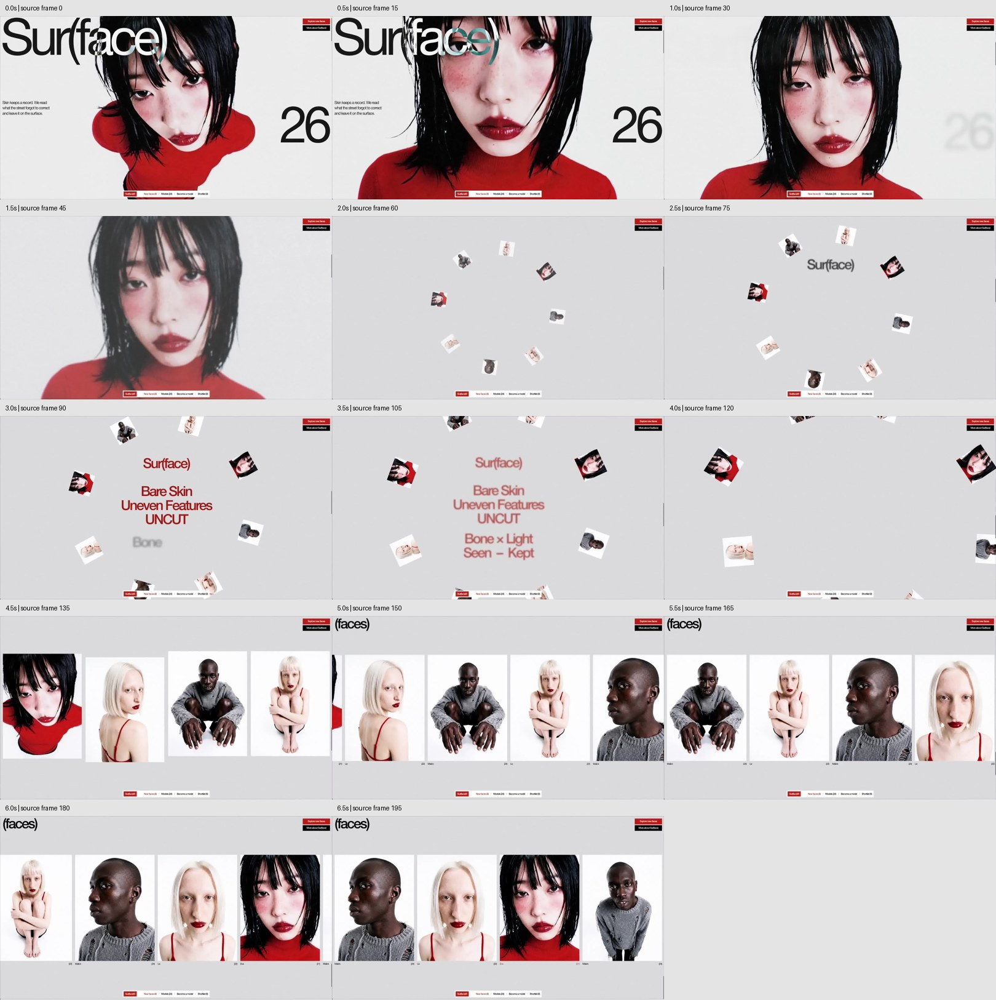
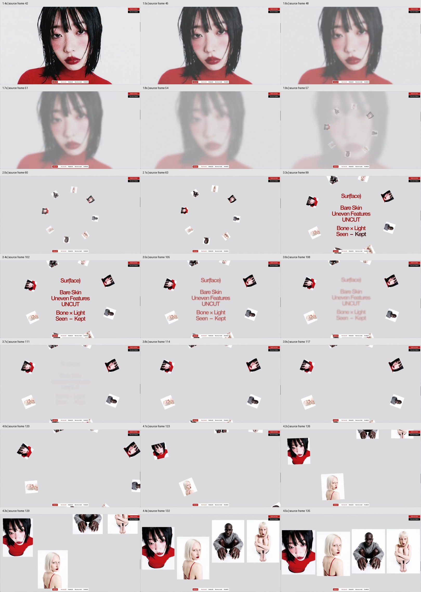

# Sur(face) 녹화 분석 및 재현 설계

## 분석 범위와 작업 기준

- 요청: 첨부한 예제와 최대한 비슷한 시각 표현과 모션을 구현. 실제 에셋은 사용자가 추후 제공하고, 완성본은 Vercel에서 공개한다. 이번 단계는 상세 분석이다.
- 작업 브랜치: `feat/namsur-recreation`.
- 기준 커밋: `574d9415b1e5418253f4ca691af142fbd6d42377`, 원격 `claude/barely-site`. 작업 시작 시 로컬은 커밋이 없었지만 원격을 다시 조회해 기존 구현을 발견했다. 기존 구현을 보존한 채 그 커밋에서 분기했다. 원격에 `main`은 조회되지 않았다.
- 자료: `motionsites.ai_namsur-faceArea.mp4`, H.264, **1956 × 1080, 30 fps, 196프레임, 6.533초**, 오디오 스트림 없음.
- 분석 방법: 0.1초 간격으로 원본의 매 3번째 프레임을 추출하여 66개 표본 확보. 전체 흐름 및 주요 전환 표본을 시각적으로 검토하고 기존 HTML/CSS/JS/빌드 코드를 읽었다.
- 아래 시간은 **녹화 시각**이다. 실제 스크롤 위치나 애니메이션 duration을 측정한 값이 아니다. 사용자의 휠 입력, 스크롤 속도, 영상 재생 시점은 녹화에 포함되지 않는다.
- 원본 DOM, 소스 파일, 사용 폰트, 라이브러리, easing 값은 녹화만으로 확정할 수 없다. 파일명에 있는 서비스명도 원본 웹사이트 URL로 단정하지 않는다. 첨부물은 관찰 자료로 사용한다.

이번 변경은 분석 문서와 참조 프레임이다. 기존 앱 구현 수정, 실제 에셋 교체, 브라우저 동작 검증, Vercel 배포는 이번 단계의 완료 항목이 아니다.

## 1. 전체 인상과 화면 구조

밝은 회색의 한 화면에 대형 인물과 타이포그래피가 놓인다. 장면이 일반 문서처럼 위로 밀려나는 대신, 화면 안의 요소가 흐려지고 커지고 재배열된다. 이 때문에 **하나의 고정 무대에서 스크롤 진행도에 따라 상태를 바꾸는 구조**가 재현에 적합하다. 원본이 실제로 이 구현을 사용한다는 뜻은 아니다.

핵심은 다음 여섯 가지다.

1. 상단 왼쪽을 크게 채우는 `Sur(face)` 로고와, 인물 위에서 달라지는 글자 색.
2. 흰 스튜디오 배경, 강한 빨강, 검은 머리 등 대비가 뚜렷한 인물 영상.
3. 텍스트가 먼저 사라지고 사진은 잠시 남은 뒤 안개처럼 흐려지는 시간차.
4. 작은 인물 사진 8장이 중앙의 문구를 둘러싸며 바깥쪽으로 확장되는 장면.
5. 단어들이 흐림 → 검정 → 적색으로 바뀌는 순차 등장.
6. 흩어진 사진들이 확대·회전 보정·이동하며 같은 높이의 세로 카드 열로 정렬되는 연결감.

상단 오른쪽 CTA 두 개와 하단 중앙의 작은 내비게이션은 이 흐름 내내 같은 화면 위치에 남는다. 별도의 그림자, 둥근 카드, 장식 UI보다 이미지 크기·여백·자간이 인상을 결정한다.



## 2. 녹화 타임라인

시점은 0.1초 표본에 기반한 근사치이며 경계는 약 ±0.1초 범위로 해석한다. 구간을 단순히 6.53초짜리 자동 재생 애니메이션으로 옮기지 않는다.

| 녹화 구간 | 관찰한 변화 | 재현할 동작 |
| --- | --- | --- |
| 0.0–0.4초 | 대형 로고, 왼쪽 소개문, 오른쪽 `26`, 전면 인물이 함께 보임. 얼굴과 몸의 상대적인 자세가 변함 | 히어로는 실제 영상/연속 이미지 동작이 중요. 정지 이미지의 단순 확대만으로는 같은 인상을 내기 어려움 |
| 0.4–1.1초 | 로고·소개문·숫자가 흐려지며 사라짐. 인물은 계속 선명하게 남음 | 텍스트 레이어의 opacity와 blur를 배경과 분리하고 약간의 시차를 둠 |
| 1.1–1.4초 | 텍스트가 사라진 뒤 인물만 남는 짧은 여유 | 다음 장면으로 즉시 넘기지 않고 이 간격 유지 |
| 1.4–2.0초 | 인물이 흐려지고 회색으로 덮임. 약 1.9초에 썸네일이 배경 위에 겹쳐 보임 | blur 증가 + opacity 감소/회색 오버레이. 끝부분에서 링과 겹치는 전환 |
| 1.9–2.3초 | 작은 사진 8장이 원형 배치로 등장·확대. 중앙은 처음에 비어 있음 | 중심 기준 카드 위치와 크기를 함께 보간. 완성된 큰 링을 갑자기 표시하지 않음 |
| 2.3–3.4초 | `Sur(face)`부터 아래쪽 문구까지 순서대로 선명해지고 적색으로 변함. 링은 계속 확장 | 단어별 reveal 진행도와 색 전환을 분리. 카드 궤적은 문구와 독립적으로 지속 |
| 3.4–3.8초 | 중앙 문구 전체가 흐려져 사라짐. 카드들은 남음 | 단어 등장과 별개로 블록 전체의 퇴장 진행도를 적용 |
| 3.8–4.1초 | 빈 중앙을 둘러싼 카드가 더 바깥으로 이동. 일부는 화면 가장자리에서 잘림 | 무대에 overflow clipping 적용. 갤러리로 이어질 카드의 위치를 보존 |
| 4.1–4.6초 | 카드가 커지며 각자의 기울기를 풀고 열로 모임. 첫 카드는 왼쪽에서, 둘째는 아래에서, 뒤쪽 카드는 위에서 들어옴 | 동일 사진의 궤적과 ID를 이어서 변환. 모든 카드를 한 방향에서 슬라이드시키지 않음 |
| 4.6–6.53초 | `(faces)` 제목과 캡션이 보이고 카드 열이 왼쪽으로 이동. 상하 위치는 안정적 | 갤러리 x 이동을 스크롤에 연결. 제목과 고정 UI는 정지. 끝점/반복 여부는 이 짧은 녹화로 확정 불가 |



## 3. 레이아웃, 색상, 타이포그래피

좌표와 크기는 원본 1956 × 1080 프레임에서 육안으로 읽은 대략적인 **시각적 경계**다. 글자의 보이는 높이와 CSS `font-size`는 같지 않다. 폰트 파일이 확정되면 기준 뷰포트에서 다시 맞춰야 한다.

| 요소 | 관찰/측정 기준 | 구현 시 주의 |
| --- | --- | --- |
| 히어로 로고 | 왼쪽 약 15px부터 화면 너비의 약 절반, 상단부터 약 285px까지 | 가는 자간과 매우 큰 글자. 폰트와 괄호 모양을 먼저 맞추고 폭을 조정 |
| 소개문 | x≈15px, y≈500px, 약 280px 폭의 3줄 | 화면 왼쪽에 붙은 작은 본문. 기본 컨테이너 가운데 정렬을 쓰면 달라짐 |
| 숫자 `26` | 우측 끝에 가까움, y≈530–750px | 로고와 별도 레이어. 페이지 번호의 의미는 확정하지 않음 |
| 우측 CTA | 우측 여백 약 12px, 상단 약 15px, 폭 약 160px, 높이 약 34px씩 | 위 빨강/아래 검정, 흰 글자. 두 버튼 사이 간격이 작음 |
| 하단 내비게이션 | x≈725–1237px, y≈1028–1068px | 흰 바탕, 빨간 브랜드 탭. 화면 하단 중앙에서 계속 고정 |
| 링 | 약 8장의 사진, 화면 중앙 부근을 둘러쌈. 초기 반경 대략 330–380px → 후기 550–650px | 반경과 개별 크기가 함께 증가. 링 전체의 일정한 자전 속도는 확인 불가 |
| 링 카드 | 초기 한 변 약 70–95px, 후기 약 120–160px의 정사각형에 가까운 외곽 | 이미지마다 기울기 다름. 일부는 얼굴이 옆/아래로 향함. 작은 틸트만으로 대체하면 인상이 달라짐 |
| 중앙 문구 | 중심 x≈980px. 전체 블록 y≈245–840px, 가장 긴 줄 폭 약 550px | 제목/세 줄/두 줄의 세 그룹. 글자 크기는 대략 75–85 CSS px부터 비교 조정할 후보 |
| 갤러리 | 사진 상단 y≈228px, 하단 y≈855px, 카드 폭 약 470px, 간격 약 15–20px | 약 3:4 비율, 화면에 약 4장과 잘린 다음 카드. 모서리 직각 |
| 갤러리 제목 | 좌측 상단의 `(faces)`, 시각적 높이 약 70px | 세로 카드 행과 별개로 고정. 우측 CTA와 같은 위쪽 여백 영역 |
| 캡션 | 카드 바로 아래 매우 작은 검은 텍스트와 괄호 숫자 | 캡션의 정확한 ID·이름 매핑은 에셋 수령 후 확정 |

색상은 인코딩된 영상에서 추출했으므로 원본 CSS 값과 일치한다고 주장하지 않는다.

- 초기 배경의 빈 영역: RGB 약 `(235,235,235)` → `#ebebeb`.
- 후기 배경의 빈 영역: RGB 약 `(218,218,220)` → `#dadadc`.
- 이미지 내부의 스튜디오 흰색은 무대 회색보다 밝다. 갤러리에서 사진 사각형과 무대가 명확하게 분리된다.
- 본문/제목은 거의 검정, CTA는 선명한 빨강, 중앙 문구는 어두운 빨강 계열. 적색의 정확한 값은 최종 에셋·폰트와 함께 조정한다.
- 글자 형태는 산세리프, 타이트한 자간, 과도하게 굵지 않은 획이다. 기존 `Inter Tight`는 비교할 후보이며 원본 폰트로 확인된 것은 아니다.

### 화면에서 판독한 문구

```text
Sur(face)

Skin keeps a record. We read
what the street forgot to correct
and leave it on the surface.

26

Sur(face)

Bare Skin
Uneven Features
UNCUT

Bone × Light
Seen – Kept

(faces)

Explore new faces
More about Sur(face)

Sur(face)® / New faces (6) / Models (24) / Become a model / Shortlist (0)
```

`×`, 괄호, 대소문자, 줄바꿈도 화면 인상의 일부다. 위 문구는 참조 전사이며 최종 브랜드·문구로 확정한 데이터가 아니다. 하단 숫자는 메뉴 표기이며 고유 사진 수를 뜻한다고 단정하지 않는다.

## 4. 모션을 구성할 방법

### 4.1 로고의 반전

밝은 배경 위에서는 검정, 검은 머리 위에서는 흰색, 피부 위에서는 청록 계열이 보인다. 흰 글자의 `mix-blend-mode: difference`가 유력한 재현 방법이다. 실제 원본 속성은 미확인이다.

로고가 이미지와 같은 합성 문맥에 있어야 한다. 부모의 background, opacity, filter, isolation에 따라 결과가 달라지므로 회색 배경에 텍스트만 놓은 상태로 검증하지 않는다. 히어로 영상의 최소 두 장면에서 확인한다.

### 4.2 히어로와 텍스트의 분리

인물의 자세 변화는 에셋 자체의 움직임으로 준비하고, 페이지 전환은 별도 진행도로 제어한다. 녹화의 얼굴 변화 전체를 `scale`이나 스크롤 프레임 시킹이라고 가정하지 않는다. 일반 영상 재생인지 스크롤 연동 영상인지는 추가 자료가 있어야 판별할 수 있다.

우선 구현 후보는 `muted autoplay playsinline loop` 영상 + poster다. 블러와 밝은 회색 덮개/불투명도 조절을 함께 사용한다. 전체 무대를 blur 처리하면 CTA와 내비게이션까지 흐려지므로 레이어를 분리한다.

### 4.3 원형 배치

카드별 고정 ID, 시작 각도, 이미지 방향, 크롭을 지정한다. 초기 후보 식은 다음과 같다.

```text
xᵢ(p) = cx + radiusX(p) × cos(angleᵢ(p))
yᵢ(p) = cy + radiusY(p) × sin(angleᵢ(p))
transformᵢ = translate(xᵢ, yᵢ) rotate(tiltᵢ(p)) scale(sizeᵢ(p))
```

`p`는 해당 구간의 0–1 진행도다. 영상에서 특히 잘 보이는 것은 바깥으로 커지는 움직임이다. 사진의 각도 변화는 있으나, 임의의 계속 도는 회전목마 효과를 강하게 추가하지 않는다. 문구가 사라진 다음에도 카드의 움직임을 이어간다.

### 4.4 단어별 문구 등장

처음부터 모든 줄이 적색으로 나타나지 않는다. 각 단어에 `opacity`, `blur`, `color`를 별도로 적용한다. 뒤 단어는 아직 흐리고, 앞 단어는 검정에서 적색으로 넘어가는 중첩 구간이 있다. 예를 들어 2.7초 표본의 `Uneven Features`는 같은 상태가 아니다.

레이아웃은 처음부터 전체 문구의 공간을 확보한다. 단어를 추가하면서 블록 높이가 바뀌면 이미 등장한 윗줄까지 밀려나 원본과 달라진다. 마지막 퇴장은 부모 블록 수준에서 처리할 수 있다.

### 4.5 링에서 갤러리로 연결

가장 중요한 구현 항목이다. 카드가 사라졌다가 별도의 카드가 나타나는 교체감보다, **같은 이미지가 공간을 이동하며 세로 프레임으로 커지는 연결감**을 우선한다.

- 같은 에셋 ID를 링 슬롯과 갤러리 슬롯에 연결한다.
- 한 요소의 위치·회전·가로세로 크기를 연속 보간하는 방법을 우선 검토한다.
- 두 DOM을 사용한다면 교체 시점의 화면상 위치, 크기, 회전, 크롭을 일치시키고 중복 노출을 방지한다.
- 정사각형 크롭이 3:4 카드로 바뀔 때 얼굴 위치가 튀지 않도록 `object-position`도 관리한다.
- 첫 4장의 도착 방향을 분리하고, 순차 도착을 짧게 중첩한다.
- 역스크롤에서도 같은 경로를 거꾸로 따라가도록 값을 현재 진행도에서 계산한다.

### 4.6 가로 갤러리

카드 전체 너비와 실제 뷰포트 너비로 최대 x 이동량을 계산한다. 녹화에서는 약 4.6초 이후 왼쪽 이동이 보인다. 무한 루프·드래그·자동 재생 여부는 확인되지 않으므로 필수 동작으로 넣지 않는다.

반복되는 얼굴은 같은 사람의 다른 사진일 수 있다. 모든 사진을 기계적으로 여러 번 반복하는 것과 구별한다. 캡션, 카드 선택, 상세페이지, hover 모션의 결과는 녹화에 없으므로 별도 설계 항목이다.

## 5. 기존 구현과의 차이

아래는 기준 커밋의 **코드 정적 검토** 결과다. 브라우저에서 실행해 차이를 계측한 결과가 아니다.

| 우선순위 | 기존 상태 | 후속 구현 방향 |
| --- | --- | --- |
| P0 | `data/models.json`은 `Bare(ly)`, `27`, 다른 카피와 생성 이미지 참조를 사용 | 사용자 최종 브랜드·에셋을 별도로 받아 교체. 기존 생성 이미지를 참조 영상 원본으로 취급하지 않음 |
| P0 | `main.js`의 링 카드와 갤러리 카드가 별도 DOM. 갤러리는 고정 `SCATTER` 좌표로 시작 | 실제 링 마지막 위치와 연결되는 변환으로 수정. 이미지/크롭의 연속성 검증 |
| P0 | `spin` 누적값과 `p * 260`으로 링이 회전 | 녹화의 카드별 위치·기울기를 기준으로 회전량 재조정. 정지/역스크롤에서도 결정적인 상태 유지 |
| P0 | 빌드가 원격 에셋 다운로드 실패를 경고만 하고 성공 종료 | 필수 에셋 누락 시 실패 처리. 배포 성공과 화면 정상 표시를 구분 |
| P1 | 중앙 글자 크기 `2.55vw` → 기준 너비에서 약 50px | 참조의 긴 줄 폭 약 550px와 줄 간격을 기준으로 더 큰 크기부터 조정 |
| P1 | 갤러리 간격 `.0055W` → 기준 너비에서 약 10.8px | 영상의 약 15–20px 간격과 비교 조정 |
| P1 | 10명의 데이터를 3회 반복해 30개 갤러리 타일 생성 | 참조의 실제 컷 순서를 데이터로 정의. 불필요한 중복 영상/이미지 제거 |
| P1 | `prefers-reduced-motion`에서도 `spin` 누적, 변환과 일부 smooth scroll은 남음 | 감소 모드에서는 움직임을 줄인 정적/단순 전환 구성. 영상과 RAF 정지도 검토 |
| P1 | 갤러리 클릭은 `figure` 클릭 핸들러, 브랜드 홈은 `span` 클릭 | 실제 동작은 버튼/링크로 제공하고 키보드 포커스·선택 상태 지원 |
| P1 | About/Become a model/Shortlist 링크에 대응하는 대상이나 화면이 없음 | 후속 기능 범위에 맞는 목적지를 만들거나 동작을 명확히 정함 |
| P1 | 이미지 호버 확대와 shortlist 빨간 테두리 추가 | 녹화에서 검증된 효과가 아님. 재현 필수 동작과 구분 |
| P1 | 갤러리 영상 로컬 경로 실패 시 원격 fallback이 있으나 히어로 영상에는 동일한 오류 복구가 없음 | poster와 영상 실패 경로를 통일하고 실제 미디어 디코딩 검증 |
| P2 | 매 RAF에서 모든 카드 변환·스타일 및 `.cap` 조회 반복 | 레퍼런스 캐시, 화면 밖 영상 정지, 활성 구간 중심 업데이트 |
| P2 | Google Fonts 외부 요청, `sharp` 의존성의 lockfile 없음 | 폰트 확보 시 자체 호스팅, 의존성 lockfile과 런타임 버전 고정 |

## 6. 구현 구조와 Vercel 준비

현재 정적 HTML/CSS/JavaScript + `sharp` 빌드 구조로 이 화면은 구현 가능하다. 이 녹화만을 재현하는 데 서버, DB 또는 Next.js 전환은 필요하지 않다. 현 구조를 바탕으로 모션 상태와 에셋 데이터를 정리하는 편이 적절하다.

제안되는 분리는 다음과 같다. 아직 생성한 애플리케이션 파일 목록은 아니다.

```text
data/                 브랜드 카피, 인물/컷/링 슬롯/갤러리 순서
assets/               실제 이미지, 영상, 폰트
motion/               구간 정의와 진행도 → 화면 상태 계산
main.js               DOM 구성, 사용자 입력, 미디어 상태 연결
style.css             레이아웃, 타이포, 반응형, 감소 모션
tools/build.mjs       최적화, 필수 에셋 검증, 배포 출력
dist/                 Vercel 정적 배포 결과
```

기존 코드의 RAF/스크롤 방식으로 먼저 정밀도를 맞춘다. 복잡한 타임라인 편집이 필요할 때 GSAP/ScrollTrigger를 검토할 수 있으나 원본이 이를 사용했다고 단정하거나 지금 추가하지 않는다. WebGL/Three.js가 필요하다는 증거도 없다.

Vercel 설정은 이미 `vercel.json`에 `npm run build`와 `dist` 출력으로 존재한다. 배포 전에는 다음이 필요하다.

1. 최종 에셋을 저장소의 로컬 파일 또는 사용자가 관리하는 안정적인 스토리지에 배치한다. 만료될 수 있는 생성 서비스 URL을 필수 경로로 두지 않는다.
2. 이미지의 참조 경로와 인코딩 포맷을 일치시킨다. 현재 빌드는 `sharp`가 없으면 원본 바이트를 `.webp` 경로에 쓸 수 있으므로 최적화 실패를 명확히 처리한다.
3. 다운로드·변환·미디어 누락 중 필수 작업 실패는 빌드 실패로 표시한다. 성공 로그만으로 검증하지 않는다.
4. `package-lock.json`과 Node 버전을 정하고 Vercel과 로컬에서 같은 빌드를 사용한다.
5. 현재 `/assets/*`의 1년 immutable 캐시를 유지한다면 교체된 파일은 해시/버전이 포함된 새 이름으로 배포한다. 같은 이름으로 덮어쓰면 오래된 사진이 남을 수 있다.
6. Vercel 프로젝트와 이 작업 브랜치를 연결해 Preview에서 검증한다. Production 대상 브랜치는 현재 원격에 `main`이 없는 상태를 고려해 별도로 정한다.
7. 빌드 결과에서 페이지·JSON·폰트·각 이미지·각 영상 요청뿐 아니라 이미지 디코딩과 영상 재생도 확인한다.

현재 Vercel 프로젝트 연결이나 배포는 수행하지 않았다. 앱 실행·빌드 검증 및 재사용 환경 설정 저장은 실제 구현/에셋 준비 단계에서 진행한다.

## 7. 후속 작업 순서와 검증 기준

1. [에셋 전달 규격](asset-handoff.ko.md)에 따라 히어로, 인물 컷, 최종 문구를 매핑한다.
2. 1956 × 1080에서 히어로 / 링+문구 / 갤러리의 정지 상태부터 맞춘다.
3. 텍스트 퇴장, 히어로 소멸, 링 확장, 문구 순차 등장, 카드 정렬을 연결한다.
4. 정상·빠른 스크롤, 역스크롤, 중간 위치 새로고침, 리사이즈를 확인한다.
5. 영상 로딩 지연, 영상 재생 실패, `prefers-reduced-motion`, 키보드 조작을 확인한다.
6. 모바일은 원본 미제공 상태이므로 별도의 반응형 해석으로 구현·표기한다.
7. production build 후 Vercel Preview에서 같은 기준 장면을 캡처해 비교한다.

비교할 핵심 프레임은 0.0초(히어로), 1.8초(블러), 2.0초(링 초기), 2.7초(단어별 등장), 3.3초(문구 완성 직전), 3.6초(문구 퇴장), 4.2초(정렬 중간), 4.6초(갤러리 진입), 5.5초(가로 이동)다. 녹화 시각을 실제 스크롤 진행도로 변환한 정답이 없으므로, 먼저 동등한 시각 상태를 맞춘 다음 사용자가 느끼는 스크롤 길이와 관성을 조정한다.

원본 주소나 추가 녹화가 있으면 미확인인 모바일, hover, 상세페이지, 영상 정지 시 동작, 역스크롤을 더 정확히 분석할 수 있다. 현재 자료만으로도 데스크톱의 보이는 구간을 구현할 설계는 가능하다.

## 참조 표본 재생성

원본 MP4는 저장소에 넣지 않았다. `reference/`에는 분석용 축소 스토리보드 두 장만 저장했다. 이 JPG들은 제품 이미지나 동영상 에셋으로 사용하지 않는다.

```bash
mkdir -p /tmp/namsur-frames
ffmpeg -hide_banner -loglevel error -i /path/to/motionsites.ai_namsur-faceArea.mp4 \
  -vf "select='not(mod(n,3))'" -fps_mode vfr /tmp/namsur-frames/frame-%03d.jpg
```

30fps 입력에서 첫 출력은 원본 프레임 0, 다음은 3, 6, …이다. 따라서 출력 순번 `k`의 녹화 시각은 `(k - 1) / 10`초다. 스토리보드는 이 중 0.5초 간격 14개, 전환 표는 1.4–2.1초와 3.3–4.5초 표본을 사용한다.
